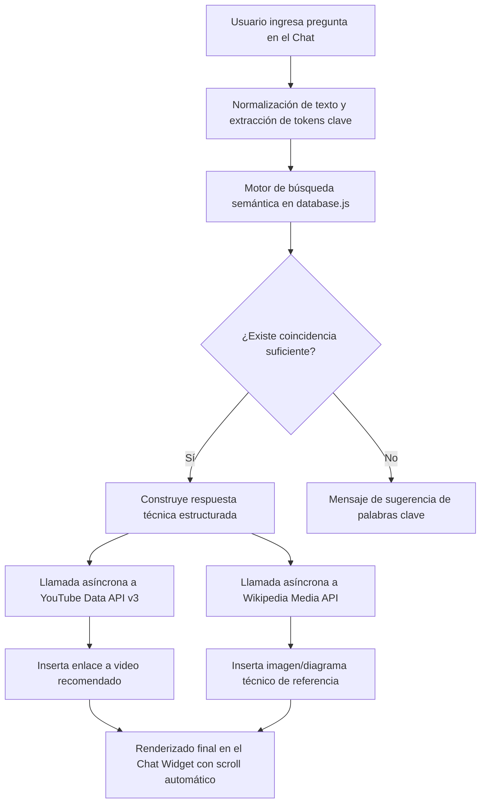

# ⚡ InfoDocs & Asistente Nexus - Ingeniería Eléctrica y Transmisión

Bienvenido al repositorio del sistema **InfoDocs & Nexus**, una plataforma interactiva y educativa diseñada para la consulta técnica especializada sobre sistemas de atenuación de iluminación (*dimmers*), conductores de alta tensión (*Arvidal AAAC 6201-T81*) y operaciones en subestaciones eléctricas.

El sistema integra una interfaz web moderna de estilo *Glassmorphism* junto con **Nexus**, un asistente virtual inteligente embebido capaz de responder consultas técnicas, recomendar videos educativos mediante la **API de YouTube** y mostrar imágenes de referencia mediante la **API de Wikipedia**.

---

## 📋 Tabla de Contenido
- [Descripción del Sistema](#-descripción-del-sistema)
- [Características Principales](#-características-principales)
- [Estructura del Proyecto](#-estructura-del-proyecto)
- [Base de Conocimiento Especializada](#-base-de-conocimiento-especializada)
- [Arquitectura y Funcionamiento del Asistente Nexus](#-arquitectura-y-funcionamiento-del-asistente-nexus)
- [Integraciones y APIs](#-integraciones-y-apis)
- [Instalación y Uso](#-instalación-y-uso)
- [Tecnologías Utilizadas](#-tecnologías-utilizadas)
- [Licencia y Créditos](#-licencia-y-créditos)

---

## 💡 Descripción del Sistema

El proyecto aborda los desafíos técnicos y de consulta en el área de ingeniería eléctrica y diseño de subestaciones. Consta de dos componentes principales:

1. **Portal Informativo (Dashboard Web):** Una interfaz visual y receptiva que presenta de forma estructurada los conceptos esenciales sobre atenuadores electrónicos de potencia y las propiedades mecánicas y eléctricas de los conductores de aleación de aluminio (Arvidal).
2. **Asistente Virtual "Nexus":** Un widget de chat flotante con motor de búsqueda semántica local que procesa preguntas de los usuarios en tiempo real, busca en la base de conocimientos técnicos y enriquece automáticamente las respuestas con contenido multimedia (videos y fotografías de referencia).

---

## ✨ Características Principales

- **Diseño Moderno & Glassmorphism:** Paleta de colores oscura (*Dark Theme*), desenfoque de fondo (*backdrop-filter*), gradientes suaves y tipografía *Inter*.
- **Widget de Chat Dinámico:** Chatbot desplegable con animaciones fluidas, indicador de escritura en tiempo real (*typing indicator*) y diseño adaptable a dispositivos móviles y de escritorio.
- **Búsqueda por Ponderación de Términos:** Motor de búsqueda local que tokeniza las consultas, filtra conectores/stop-words y calcula coincidencias ponderadas sobre los textos técnicos.
- **Enriquecimiento Multimedia Automático:**
  - **YouTube Data API v3:** Detección de tema y consulta automática del mejor video explicativo en YouTube.
  - **Wikipedia API:** Búsqueda y renderizado directo de imágenes ilustrativas y diagramas técnicos relevantes.
  - **Soporte Unsplash (Opcional):** Arquitectura preparada para consulta de banco de imágenes de alta resolución.
- **Sin Dependencias de Servidor (Client-Side):** Todo el sistema se ejecuta íntegramente en el navegador web del usuario, lo que garantiza velocidad, portabilidad y bajo costo de despliegue.

---

## 📁 Estructura del Proyecto

```text
IA/
├── IA.html                     # Archivo principal HTML (Interfaz y lógica del cliente)
├── README.md                   # Documentación completa del proyecto
├── static/
│   ├── database.js             # Base de conocimientos estructurada en JavaScript
│   └── ia.css                  # Hoja de estilos CSS (Glassmorphism, animaciones, layout)
└── info/
    ├── Atenuador.docx          # Documento técnico fuente: Atenuadores y Dimmers
    └── Linea de transmisión (arvidal).docx # Documento fuente: Conductor Arvidal
```

---

## 📚 Base de Conocimiento Especializada

El asistente Nexus contiene información técnica detallada sobre:

### 1. Atenuadores (Dimmers) en Subestaciones
- **Tecnologías de Corte de Fase (*Phase-Cut*):**
  - *Leading-Edge (TRIAC):* Conmutación al inicio de onda senoidal, ideal para cargas resistivas e incandescentes tradicionales.
  - *Trailing-Edge (MOSFET/IGBT):* Conmutación al final de onda senoidal, indispensable para drivers de iluminación LED moderna evitando picos inductivos.
- **Aplicación Industrial:** Salas de control, centros de mando y consolas SCADA (protocolos 0-10V, DALI e integración BMS).
- **Atenuadores de Telecomunicación:** Atenuadores ópticos de RF y fibra en distribuidores ODF y relés de protección.
- **Resolución de Fallas:** Mitigación de interferencia electromagnética (EMI), filtrado RFI, eliminación de parpadeo (*flickering*) y zumbido (*humming*).

### 2. Conductor Arvidal (Aleación 6201-T81 / AAAC)
- **Propiedades:** Aleación de Aluminio-Magnesio-Silicio tratada térmicamente, combinando ligereza y gran resistencia a esfuerzos electrodinámicos de cortocircuito.
- **Uso en Patios de Subestación:** Barras colectoras (*busbars*) flexibles y puentes de conexión entre interruptores, transformadores de corriente y seccionadores.
- **Instalación y Montaje:** Aplicación de pasta inhibidora de corrosión galvánica (*penetrox*), conectores bimetálicos, cálculo de tensión mecánica y flecha (*sag*).
- **Fenómenos Eléctricos Críticos:**
  - *Efecto Skin:* Conducción superficial y resistencia en corriente alterna.
  - *Efecto Corona:* Gradiente superficial crítico, ionización y atenuación mediante conductores en haz (*bundles*) y espaciadores.
  - *Efecto Ferranti:* Sobrevoltajes en extremos receptores de líneas largas bajo vacío o carga ligera.
  - *Fatiga Mecánica:* Amortiguadores tipo *Stockbridge* frente a vibraciones eólicas.

---

## 🧠 Arquitectura y Funcionamiento del Asistente Nexus



1. **Captura y Tokenización:** La entrada del usuario se limpia de signos de puntuación y palabras cortas para extraer los conceptos clave (ej. `corona`, `subestacion`, `triac`, `flecha`).
2. **Scoring:** Cada párrafo de `database.js` recibe una puntuación basada en ocurrencia exacta y de subcadena.
3. **Respuesta Contextualizada:** Se extrae y formatea el contenido más relevante en negritas y viñetas legibles.
4. **Enriquecimiento Asíncrono:** De forma paralela mediante `fetch`, se consulta YouTube y Wikipedia para añadir recursos visuales inmediatos.

---

## 🔌 Integraciones y APIs

- **YouTube Data API v3:**
  - Permite localizar automáticamente videos técnicos explicativos acordes a la consulta del usuario.
  - Endpoint: `https://www.googleapis.com/youtube/v3/search`
- **Wikipedia Media API:**
  - Consulta enciclopédica sin necesidad de autenticación, obteniendo imágenes originales o miniaturas de alta resolución (`prop=pageimages`).
  - Endpoint: `https://es.wikipedia.org/w/api.php`
- **Unsplash API (Extensión opcional):**
  - Código preparado para integrar una clave de acceso (`UNSPLASH_ACCESS_KEY`) para galerías fotográficas en tiempo real.

---

## 🚀 Instalación y Uso

### Requisitos Previos
No se requieren dependencias complejas ni entornos de ejecución de backend (Node.js, Python, PHP, etc.), únicamente un navegador web moderno (Google Chrome, Mozilla Firefox, Microsoft Edge, Safari).

### Pasos para Ejecutar Localmente

1. **Clonar el repositorio:**
   ```bash
   git clone https://github.com/buxworld1999/IA.git
   cd IA
   ```

2. **Abrir la aplicación:**
   - Simplemente haz doble clic sobre el archivo `IA.html`.
   - O ábrelo mediante cualquier servidor estático local (recomendado para evitar restricciones locales de CORS en ciertos navegadores):
     ```bash
     # Usando Python
     python -m http.server 8000
     # Luego ingresa a http://localhost:8000/IA.html en tu navegador
     ```
     ```bash
     # Usando Node.js (npx)
     npx serve .
     ```
     O utiliza la extensión **Live Server** de Visual Studio Code.

3. **Interactuar con el Asistente:**
   - Haz clic en el botón circular flotante inferior derecho para abrir a **Nexus**.
   - Prueba preguntas como:
     - *¿Qué es el efecto corona en conductores Arvidal?*
     - *¿Cuál es la diferencia entre dimmers Leading-Edge y Trailing-Edge?*
     - *¿Cómo se instala el conductor Arvidal en una subestación?*
     - *¿Qué fallas provocan los atenuadores en salas de control?*

---

## 🛠️ Tecnologías Utilizadas

- **HTML5:** Marcado semántico y estructura accesible.
- **CSS3:** Variables CSS (`:root`), Flexbox, CSS Grid, animaciones `@keyframes`, y efectos visuales de cristal (*Glassmorphism*).
- **JavaScript Moderno (ES6+):** Funciones asíncronas (`async/await`), `Fetch API`, manipulación del DOM y lógica de puntuación de texto.
- **Google Fonts:** Tipografía *Inter*.
- **APIs Web Externas:** Google YouTube Data API v3 y Wikimedia REST API.

---

## 👤 Autor

- **GitHub:** [@buxworld1999](https://github.com/buxworld1999)
- **Repositorio:** [https://github.com/buxworld1999/IA.git](https://github.com/buxworld1999/IA.git)
